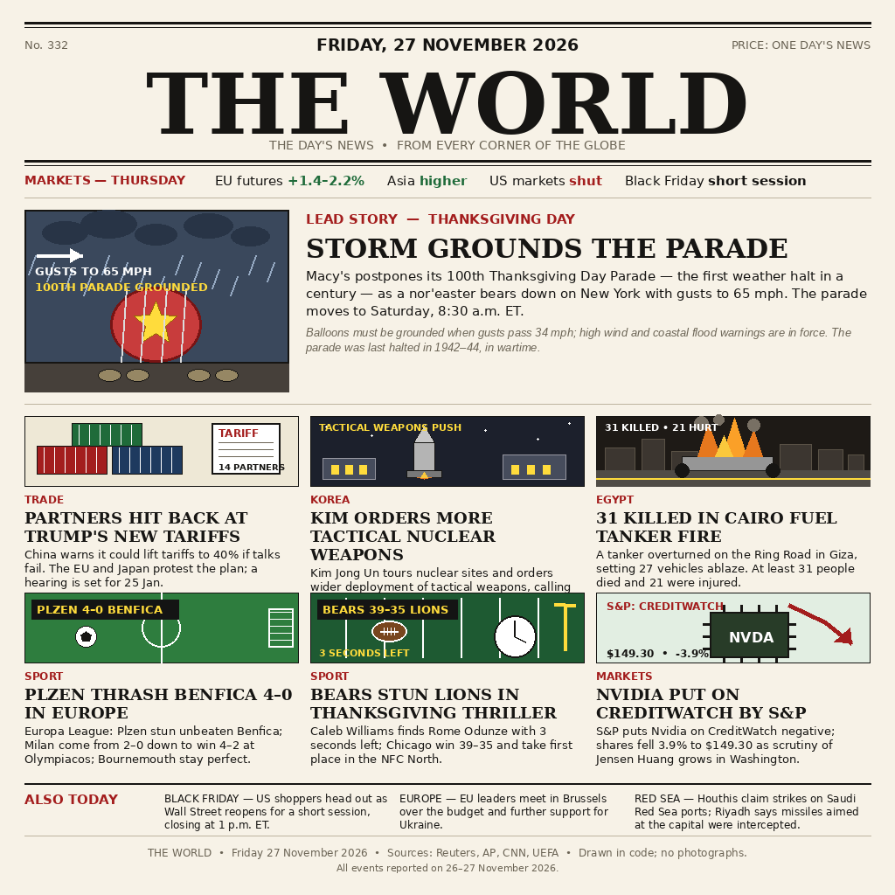

# THE WORLD — Friday 27 November 2026


Entry for the [news-image-20261127 bounty](https://make.fun/bounty/news-image-20261127):
sum up 27 November's world news in one image.



## The front page

A code-drawn newspaper front page, **THE WORLD**, dated Friday
27 November 2026.

- **Lead story:** a nor'easter grounds Macy's 100th Thanksgiving Day
  Parade — the first weather postponement in the parade's century —
  with gusts to 65 mph in New York. The parade moves to Saturday,
  8:30 a.m. ET.
- **Grid:** trading partners hit back at Trump's new tariffs (China
  warns it could lift tariffs to 40%); Kim Jong Un orders more
  tactical nuclear weapons; 31 killed in a fuel tanker fire on
  Cairo's Ring Road; Plzen thrash Benfica 4–0 in the Europa League;
  the Bears stun the Lions 39–35 in a Thanksgiving thriller; S&P
  puts Nvidia on CreditWatch negative.
- **Also today:** Black Friday as Wall Street reopens for a short
  session; EU leaders meet in Brussels over the budget and Ukraine
  aid; the Houthis claim strikes on Saudi Red Sea ports.

Every illustration is drawn in code — no photographs, no network.

## Files

| File | What it is |
| --- | --- |
| `entry.png` | The poster, 1024 x 1024, 150,717 bytes |
| `draw_poster.py` | The program that draws the poster (Pillow) |
| `main.py` | Stdlib-only entrypoint: copies `entry.png` to the output directory and verifies size, dimensions and sha256 |
| `RESEARCH.md` | The facts behind every story, and what was deliberately left out |
| `BUILD.md` | Layout plan and build notes |

## Run it

```sh
python3 draw_poster.py        # redraw entry.png
MAKEFUN_OUTPUT_DIR=out python3 main.py   # copy it to out/entry.png
```

## Sources

Reuters, AP, CNN, UEFA. See `RESEARCH.md` for the facts and for
the figures that were left out because sources conflicted.
